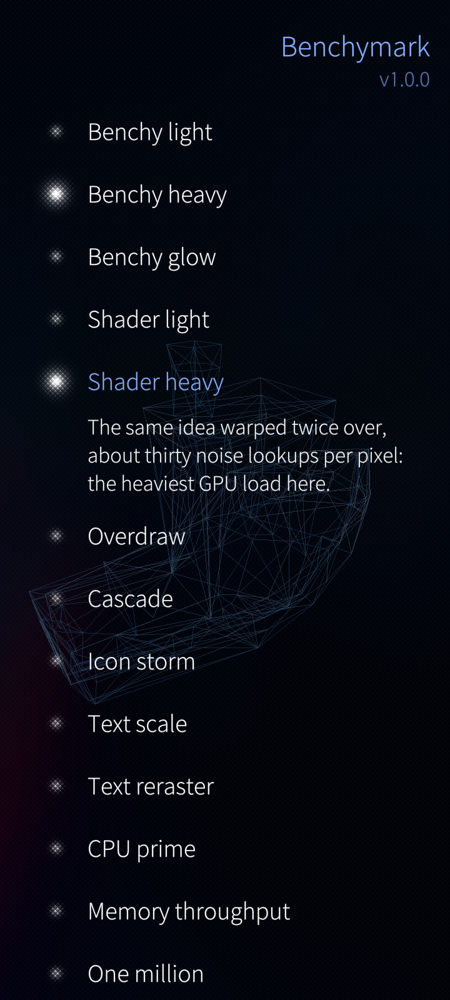
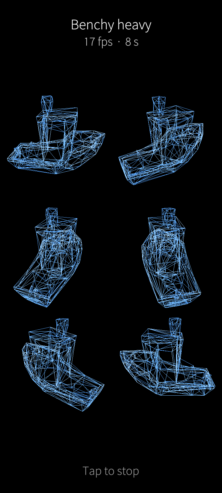
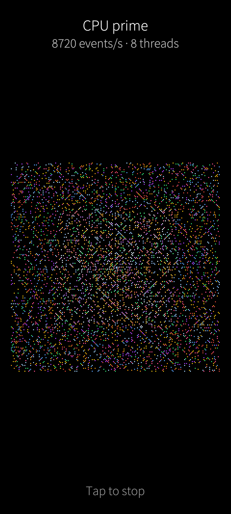
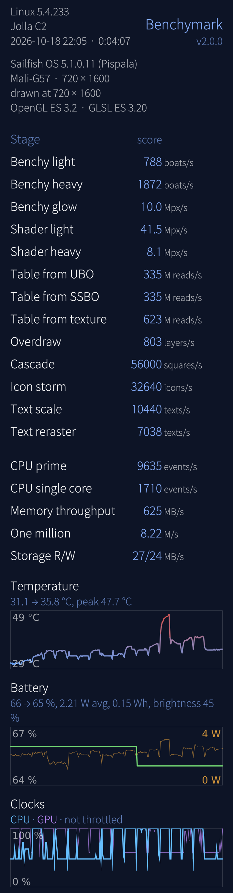
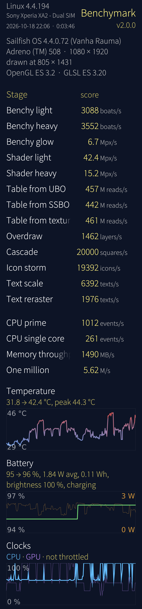
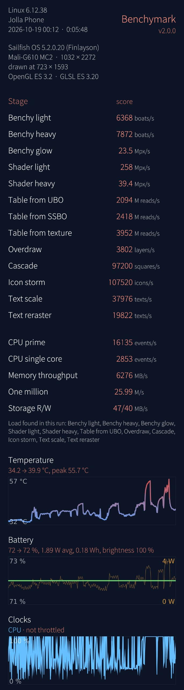

# benchymark


**A rendering benchmark for [AsteroidOS](https://asteroidos.org/) watches.**
Install it, tap it, and twelve fixed phases tell you what your watch is actually
good and bad at — with the frame rate live on the screen and a result file you
can keep.

https://github.com/user-attachments/assets/adec3f6d-6174-4b50-b96d-a8a980a92be8

## SailfishOS


The `sailfishos` branch is **Benchymark for SailfishOS phones**, the first
benchmark app for SailfishOS. In 2018 someone asked on talk.maemo.org for
exactly that ([*Missing benchmark application for Sailfish os*](https://talk.maemo.org/showthread.php?t=100457));
the author answered with the shell commands he had used for his 2016 device
comparison and wrote that *"some common linux commands could indeed be
utilized by an application and have a nice front end"*. This is that front end.

Video: [Benchymark on a Jolla C2 and the Jolla Tablet](https://youtu.be/HsU34zeBwqI)

The loop from the watch closes on the phone too. 3DBenchy is the object
3D printers are tested with; on those printers the community prints parts for
the Jolla Phone 2 and for Linux phones in general. The phone now draws the boat
that certified the printer that made its parts, and SailfishOS has no 3D
engine for it either: `src/Wireframe.cpp` rotates and projects the mesh itself,
every line, every frame.

Tick the stages you want, choose a run mode, start:

- **Run once**: the sequence once, for comparable results
- **Run one hour**: the sequence over and over, ending at exactly 1:00:00, a
  defined battery and temperature test. The display runs at 50 % brightness
  with automatic brightness off and is set back afterwards (after a crash, at
  the next start), so drains compare
- **Run in loop**: until you tap, to diagnose overheating and throttling

### Scores that compare across devices (2.2)

Up to 1.3 every stage drew at the screen's own resolution and the result was
frames per second: a tablet with four times the pixels did four times the
work, and fast phones hit their refresh rate (60, 90, 120 Hz) and stopped
telling anything. 2.0 promised scores that compare across devices and did
not deliver them. It drew a fixed number of pixels in the screen's own
shape, found a load per device that fell under 25 fps, and counted frames
on screen. Testers on more devices showed the flaws, and an audit
(2026-10-19) found the cause in the method itself: the frame rate of a
window on screen carries the refresh cap and a fixed cost of 12-25 ms per
frame for compositing and scaling, so a score depended on which load a
device landed on, by 40-170 %. 2.2 measures differently:

- **One canvas for everyone**: every stage is laid out and drawn on the
  same 720 × 1600 canvas, on every device
- **Off screen**: a graphics stage draws into a framebuffer of its own, as
  fast as the device can, with no vsync, no compositor and no scaling to
  the screen (`src/Offscreen.*`, Qt's QQuickRenderControl). The screen
  shows a copy of its frames while it warms up
- **The same work everywhere**: each graphics stage has one fixed load,
  the same on every device (320 boats, 72 layers, 4000 squares, ...), and
  its motion follows the frame number, not the clock: every device draws
  exactly the same frames. No calibration, nothing per device
- **Measured**: two seconds of warm-up, not counted, then six seconds. The
  score is the work drawn over the time it took, with the GPU finished, in
  the stage's own unit (boats/s, Mpx/s, M reads/s, layers/s, squares/s,
  icons/s). The two halves of the six seconds give two scores of their own;
  a row whose halves differ by more than ±10 % is marked
- **What it means**: the throughput of the device's drawing, CPU and GPU
  together, under full load. That is not the frame rate an app gets on
  screen: off screen nothing waits for the display, so the CPU never idles
  between frames and keeps its clock up. Stages whose work is mostly on the
  CPU (Benchy, Cascade) score much higher than on screen on a phone whose
  cores sleep between frames (an Xperia XA2 about three times higher)

Each graphics stage takes eight seconds on a black background (the ambience
must not change the result), ten with **Show stages moving** (Settings, on
by default): two seconds on screen at the display's own pace first, for the
eye, not measured. The system stages run their own course and count from
their second second on. The results
show the device, kernel, OS, GPU, screen and render size, the OpenGL ES and
GLSL versions, the date and exact runtime, every stage's score with its unit
(a tap on a stage says what its score counts), then three curves over the
whole run, one point a second:

- **Temperature**: the hottest CPU, SoC or GPU sensor
- **Battery**: the charge and the power drawn, with the average watts, the
  energy in Wh, percent per hour (from ten minutes on) and the brightness at
  the start
- **Clocks**: the fastest CPU cluster and the GPU in percent of their maximum,
  red where the kernel throttled (a cooling device active, or a cluster
  capped below its maximum). The journal is closed to apps, so this is read
  from sysfs

The pulley menus do the rest, as SailfishOS apps do. On the start page:
**Settings**, **Select all**, **Deselect all** and **Start run**, the last
one flick from the top; the same **Start run** button sits below the
stages. On the results:
**Settings**, **Back to stages**, **Share JSON** and **Share image**. Share
image saves the whole results page as one tall picture to
Pictures/Screenshots, with all system details whatever you switched off, says
where it went and opens the share menu with it (the app asks once for the
Pictures permission). Share JSON shares the full
run, all curves, loads and fps included; when no GPU clock was found it
also lists where the app looked and what it could read. Every run is kept,
one file each in `~/.local/share/net.mowerk/harbour-benchymark/runs/`, the
last one also as `last-run.json` there. Settings has two tabs: **Settings**
(the start page hints, the score descriptions, and which system details the
results show) and **Results**, every saved run, newest first; a tap opens
it, a long press deletes it or picks it for **Compare with…**: the next run
tapped is shown beside it, stage by stage, with the ratio.

      

| stage | what it leans on | score |
|---|---|---|
| Benchy large | two large 3DBenchy wireframes, each drawn many times: CPU projection, line drawing; a large boat has twice the lines' length of a small one | boats/s |
| Benchy small | six small boats, each drawn many times: the same CPU work per boat, half the lines' length | boats/s |
| Benchy glow | a Benchy with blur halos stacked over the whole picture, pulsing by their spread | Mpx/s |
| Shader light | a domain-warped noise field per pixel, several times over (the watch's CLOUDLIGHT) | Mpx/s |
| Shader heavy | the doubly warped fBm field (the watch's CLOUDHEAVY) | Mpx/s |
| Table from UBO | every pixel walks a 16 KB table, each index from the entry before, from a uniform buffer (UBO); OpenGL ES 3.0 | M reads/s |
| Table from SSBO | the same walk from a shader storage buffer (SSBO); OpenGL ES 3.1 with storage buffers in fragment shaders | M reads/s |
| Table from texture | the same walk from a float texture (`texelFetch`), the baseline for the two buffers; OpenGL ES 3.0 | M reads/s |
| Overdraw | big translucent squares, stacked and turning: fill rate | layers/s |
| Cascade | rounded squares in two transformed rings | squares/s |
| Icon storm | SVG icons (flashes and Twemoji rockets) on spiral arms | icons/s |
| CPU prime | sysbench's cpu event (primes up to 10000) on every core the SoC has, one per cell of an Ulam spiral; an armv7hl build uses the divide instruction where the core has one | events/s |
| CPU single core | the same on one thread | events/s |
| Memory throughput | memcpy between two 32 MB buffers | MB/s |
| One million | JavaScript counting to one million, over and over, in a worker, timed by the worker itself | M/s |
| Storage performance | 256 MB in 16 KB blocks with O_DIRECT, written and read, then deleted. Off by default (flash wear) | MB/s |

Results with 2.2 (scene `sfos-2.2`), by the author, the mean of two full
runs back to back (2026-10-19); the two agree within ±2 % on nearly every
stage, at most 10 % (the XA2's Icons):

| stage | Xperia XA2 (4.4, Adreno 508, armv7hl) | Jolla Tablet (4.6, Intel HD BayTrail) | Jolla C2 (5.1, Mali-G57) |
|---|---|---|---|
| Benchy large | 12719 boats/s | 2184 boats/s | 959 boats/s |
| Benchy small | 13008 boats/s | 5061 boats/s | 2273 boats/s |
| Benchy glow | 45.5 Mpx/s | 19.5 Mpx/s | 38.6 Mpx/s |
| Shader light | 50.4 Mpx/s | 30.2 Mpx/s | 48.0 Mpx/s |
| Shader heavy | 17.4 Mpx/s | 7.3 Mpx/s | 8.6 Mpx/s |
| Table from UBO | 635 M reads/s | 327 M reads/s | 413 M reads/s |
| Table from SSBO | 615 M reads/s | – (needs OpenGL ES 3.1) | 414 M reads/s |
| Table from texture | 648 M reads/s | 150 M reads/s | 964 M reads/s |
| Overdraw | 2305 layers/s | 722 layers/s | 662 layers/s |
| Cascade | 96126 squares/s | 91230 squares/s | 85879 squares/s |
| Icon storm | 16041 icons/s | 17595 icons/s | 30960 icons/s |
| CPU prime | 9435 events/s (8 threads) | 1290 events/s (4) | 9826 events/s (8) |
| CPU single core | 1358 events/s | 359 events/s | 1718 events/s |
| Memory throughput | 1509 MB/s | 909 MB/s | 632 MB/s |
| One million | 48.8 M/s | 305 M/s | 246 M/s |

The XA2 draws the Benchy boats six to thirteen times faster than the C2,
though the C2's single core is faster: on the C2 the lines limit (small
boats, with half the lines' length, score 2.4 times the large ones), on the
XA2 the projection on the CPU does (large and small score alike). The C2's Mali reads a table from a
texture best and the Adreno all three ways alike; the tablet has no
SSBO. One million compares script engines: the x86 and aarch64 JITs count
five times faster than the XA2's armv7. The tablet's graphics driver
hands back a blank picture, so its Share image is empty (Share JSON works).

<details>
<summary>Results with 2.0 (scene `sfos-2.0`, one load per stage: not comparable with 2.2)</summary>

By the author; the Jolla Phone run is by forum user ahjolinna
([thread](https://forum.sailfishos.org/t/35153)).

| stage | Jolla Phone (5.2, Mali-G610 MC2) | Jolla C2 (5.1, Mali-G57) | Xperia XA2 (4.4, Adreno 508) | Jolla Tablet (4.6, Intel HD BayTrail) |
|---|---|---|---|---|
| Benchy light | 6368 boats/s | 788 boats/s | 3088 boats/s | 968 boats/s |
| Benchy heavy | 7872 boats/s | 1872 boats/s | 3552 boats/s | 2412 boats/s |
| Benchy glow | 23.5 Mpx/s | 10.0 Mpx/s | 6.7 Mpx/s | 5.0 Mpx/s |
| Shader light | 258 Mpx/s | 41.5 Mpx/s | 42.4 Mpx/s | 18.4 Mpx/s |
| Shader heavy | 39.4 Mpx/s | 8.1 Mpx/s | 15.2 Mpx/s | 6.9 Mpx/s |
| Table from UBO | 2094 M reads/s | 335 M reads/s | 457 M reads/s | 112 M reads/s |
| Table from SSBO | 2418 M reads/s | 335 M reads/s | 442 M reads/s | – (needs OpenGL ES 3.1) |
| Table from texture | 3952 M reads/s | 623 M reads/s | 461 M reads/s | 76 M reads/s |
| Overdraw | 3802 layers/s | 803 layers/s | 1462 layers/s | 342 layers/s |
| Cascade | 97200 squares/s | 56000 squares/s | 20000 squares/s | 40800 squares/s |
| Icon storm | 107520 icons/s | 32640 icons/s | 19392 icons/s | 17472 icons/s |
| Text scale | 37976 texts/s | 10440 texts/s | 6392 texts/s | 4246 texts/s |
| Text reraster | 19822 texts/s | 7038 texts/s | 1976 texts/s | 1560 texts/s |
| CPU prime | 16135 events/s | 9635 events/s | 1012 events/s | 1282 events/s |
| CPU single core | 2853 events/s | 1710 events/s | 261 events/s | 359 events/s |
| Memory throughput | 6276 MB/s | 625 MB/s | 1490 MB/s | 892 MB/s |
| One million | 25.99 M/s | 8.22 M/s | 5.62 M/s | 6.09 M/s |
| Storage R/W | 47/40 MB/s | 27/24 MB/s | – | 42/32 MB/s |

Each GPU reads the table its own way: on the Jolla Phone's Mali the SSBO
beats the UBO and the texture is fastest, on the C2's Mali the UBO and the
SSBO cost the same and the texture is twice as fast, on the XA2's Adreno all three
are even, on the tablet's Intel the UBO beats the texture and there is no
SSBO. The XA2 runs the armv7hl build, which divides in software, so its CPU
prime is low for its chip. The tablet's i486 build saves an empty Share
image: its graphics driver hands back a blank picture (a known issue; Share
JSON works).

</details>

<details>
<summary>Results with 1.x (fps at each screen's own resolution, not comparable with 2.0)</summary>

The Jolla Phone and Xperia 10 II runs are by forum user ahjolinna
([thread](https://forum.sailfishos.org/t/35153)), the Moto G by Mir Inza, the
Xiaomi Pad 6 by Mister Magister. The Jolla Phone's 90 fps and the Pad 6's
102 and 109 are their display refresh: exactly what 2.0 fixes.

| stage | Jolla Phone (5.2, Mali-G610 MC2) | Xperia 10 II (5.2, Adreno 610) | Jolla C2 (5.1, Mali-G57) | Jolla Tablet (4.6, Intel HD BayTrail) | Moto G 2nd gen (5.1, Adreno 305) | Xperia XA2 (4.4, Adreno 508) | Xiaomi Pad 6 (5.1, Adreno 650) |
|---|---|---|---|---|---|---|---|
| Benchy light | 90 | 60 | 35 | 28 | 57 | 59 | 102 |
| Benchy heavy | 42 | 39 | 16 | 14 | 19 | 25 | 55 |
| Benchy glow | 20 | 8 | 10 | 4 | 4 | 5 | 15 |
| Shader light | 75 | 24 | 32 | 8 | 10 | 20 | 109 |
| Shader heavy | 16 | 8 | 7 | 2 | 3 | 8 | 33 |
| Overdraw | 34 | 15 | 11 | 4 | 10 | 15 | 30 |
| Cascade | 68 | 38 | 40 | 25 | 17 | 24 | 51 |
| Icon storm | 79 | 27 | 24 | 13 | 7 | 13 | 44 |
| Text scale | 77 | 36 | 44 | 12 | 26 | 29 | 70 |
| Text reraster | 49 | 13 | 33 | 7 | 10 | 12 | 21 |
| CPU prime | 16327 events/s | 11153 events/s | 9719 events/s | 1271 events/s | 404 events/s | 1012 events/s | 17182 events/s |
| Memory throughput | 6213 MB/s | 3749 MB/s | 650 MB/s | 991 MB/s | 557 MB/s | 1527 MB/s | 13004 MB/s |
| One million | 26.81 M/s | 13.08 M/s | 8.28 M/s | 5.68 M/s | 2.58 M/s | 5.67 M/s | 20.45 M/s |
| Storage R/W | 45/35 MB/s | 22/29 MB/s | 27/24 MB/s | 42/32 MB/s | – | – | – |

</details>

The system stages rebuild the author's 2016 console tests (sysbench cpu and
memory, `dd`, a bash counting loop) inside the app, because the sandbox runs
no outside tools; app and service start times from that list cannot be
measured from inside the sandbox at all. With the drawing running alongside,
the numbers are not comparable to the 2016 ones either.

**Not comparable with the watch.** The results are stamped scene `sfos-2.2`.
The watch's scene 0.6 runs other loads on another renderer (Qt 6) and on
screen, and Qt 5.6 on SailfishOS has no QtQuick.Shapes or MultiEffect, so the
Benchy is drawn by a C++ scene graph item (`src/Wireframe.*`), the shaders are
GLSL ES 1.00 inline, and the table stages are raw OpenGL ES 3.x in
`src/BufferRead.*`, since ShaderEffect cannot bind buffers.

Install: `devel-su pkcon install-local harbour-benchymark-2.2.0-1.<arch>.rpm`
(aarch64, armv7hl or i486; built for SailfishOS 4.5, runs on 4.4 too). Build
with the Sailfish Platform SDK: `mb2 -t SailfishOS-4.5.0.18-aarch64 build`.
The icon is generated by `tools/benchy_icon.py`, the mesh header by
`tools/mesh_to_header.py`. Test hooks: `SFOS_SELFTEST_RUN=<stage index>` runs
one stage at start (-2 all ticked ones), `SFOS_SELFTEST_STOP=<s>` ends it
after that many measured seconds, `SFOS_SELFTEST_SHARE=1` saves the share
picture as `share-test.png` in the app's data directory (and a copy in
Pictures/Screenshots), `SFOS_SELFTEST_PAGE=settings|runs|compare` opens that
page, `SFOS_OFFSCREEN_TEST=<stage file>:<load>,<load>,...[:<warm ms>:<measure ms>]`
measures one graphics stage off screen at the loads given, logs each result
and quits. Scripts in the author's workspace drive these over ssh. A
headless test with the display off needs a wakelock: with autosleep the
device suspends every second or two, and the run measures the naps.

Credits for the phone version: Twemoji graphics (c) Twitter, Inc and other
contributors, CC-BY 4.0 (the rocket); ionicons, MIT (the flash); the icon's
leaf shape after the SailfishOS stock icons.
Forum user ahjolinna ran the first results on other devices and suggested
the CPU single core stage, the temperature curve as a thermal test and
sharing the results, all in 1.1.0
([thread](https://forum.sailfishos.org/t/35153)).
Mister Magister asked for the kernel version and inspired the
battery drain and CPU throttling curves, all in 1.2.0, and his Xiaomi Pad 6
results raised the question that led to 2.0: do phones with more pixels get
more work?
Mir Inza shared the Moto G 2nd gen results and with them the bug report
for the temperature on old kernels that report whole degrees, fixed in 1.2.1.
Keijø read the OS version as the kernel's in the results header, which
gave the 1.3.0 header one named fact a line, and kan_ibal asked for a
UBO/SSBO comparison: the GL version line in 1.3.0 and the three table
stages in 2.0.0.

The SailfishOS version was written by an LLM (Claude), directed by the
author: he chose the stages, their order and loads, the start page, the
results table and the icon, the 2.0 scoring and its SailfishOS-style menus
and settings, and tested every round on his Jolla C2, an Xperia XA2 and the
Jolla Tablet.

```
Disclosure: LLMGD-3 · origin O1 (the author's app and his design for the phone, set and tested by him on a Jolla C2 over many rounds; LLM-implemented; self-graded)
LLMGD: v0.3; assurance=A3; flags=U,T; origin={O0:.5,O1:.5}; origin_headline=O1; scope=port(code+assets+packaging+docs); graded-by=claude-opus-5-5; retrieval=author-side
```

## The loop

3DBenchy exists to benchmark **3D printers**. This community 3D-prints
**custom docks** for its watches, and posts finished ones to members who have no
printer. So the little boat that certifies the printer, that makes the dock,
that holds the watch — now certifies the watch as well.

That is not decoration. Because QtQuick3D is absent on these images, nothing
here *loads* a model: the QML **is** the renderer, rotating the hull and
projecting it through a perspective divide every single frame. Your watch is
drawing, by arithmetic, the object that certified the printer that made its own
cradle.

## What you see

1. A **countdown**, so you can get to the watch before it starts.
2. **Twelve phases**, back to back, with a quiet two seconds between them. The
   name of the phase about to run fades up in the middle of that gap.
3. The **live FPS travels the screen rim**, trailing older readings behind it —
   the trail *is* the history, no graph needed. One lap per phase, so it starts
   and finishes at the top. Numerals drop to **red below 45 fps**.
4. A **COMPLETE** screen. Tap to run it again.

The whole run takes about three minutes and holds the screen awake by itself.

**Or take control.** Tap during the countdown and it pauses, offering two
buttons: **continue** (for a mis-tap) or **phase control**. In phase control the
current phase runs *indefinitely* and a tap moves to the next one — so you can
park on the one test you actually care about instead of waiting for it to come
round. Results from a manually-cut phase are marked `"manual": true`, because a
window you ended by hand is not comparable with a full one.

## Install

Grab the `.ipk` from [Releases](../../releases), then on the watch as root:

```sh
opkg install benchymark_*.ipk --force-reinstall --force-depends
```

It appears in the launcher as **Benchymark**. Building from source is in
[packaging/benchymark.bb](packaging/benchymark.bb).

## What it measures

Each phase isolates **one** cost path, so a result points at a cause instead of
handing you a score:

| phase | what it leans on |
|---|---|
| `IDLE` | nothing — the sanity floor. Should sit at a flat 60. |
| `SCALE` | scaling text with a transform |
| `RERASTER` | the **same picture**, resized the expensive way |
| `ORBIT` | a moving element with a pulsing halo |
| `OVERDRAW` | stacked translucent layers — raw fill rate |
| `DRAWCALLS` | many separate SVG icons in motion |
| `DRAWFONT` | the same storm as colour emoji glyphs |
| `SHAPES` | a vector path rebuilt every frame |
| `CASCADE` | two counter-rotating trees of moving children |
| `CLOUDLIGHT` | a domain-warped cloud, cheaply |
| `CLOUDHEAVY` | the same cloud, built to hurt |
| `BENCHY` | the boat, as a rotating wireframe |

**`SCALE` and `RERASTER` are the centrepiece.** They look *identical on screen*
and differ only in how the resize is done — a `scale` transform versus animating
`font.pixelSize`. Their ratio is the most transferable number in the run: on
nemo it is 55 against 21, which is what animating text size really costs.

The two **clouds** are one scene at two costs — 24 against 140 hash evaluations
per pixel — so the pair prices the domain warp and the `sin()`-based hash
together. `CLOUDHEAVY` is the deliberate worst case.

## Results

Each completed run is written to
`~/.local/share/benchymark/last-run.json`:

```json
{
 "scene": "0.6",
 "finished": "2026-08-29T18:52:11.000Z",
 "resolution": "384x384",
 "phases": [ { "phase": "IDLE", "avg": 60, "min": 59, "samples": 9,
               "worst_tick_ms": 118 } ]
}
```

One complete run per file, written when the last phase closes — so a tool
collecting these never reads a half-finished result. Fleet managers such as
[asteroid-docking-bay](https://github.com/moWerk/asteroid-docking-bay) can
install, launch and read it back over ADB or SSH.

## Comparing numbers honestly

- The **scene version** shows during the countdown and is stamped into every
  result. If the scene changes, old numbers are void.
- **Bigger panels do more work** in the fill-rate phases. That is real, so
  compare like with like, or report Mpix/s alongside FPS.
- Every phase runs ten seconds and **measures nine** — the first is discarded,
  because it straddles the gap and the scene's opening frames.
- **`worst_tick_ms`** is how far the worst one-second sampling window drifted
  from the second it asked for. The sampler runs on the GUI thread, which a
  GUI-bound phase starves, so a large value means the samples behind that
  average were counted over ragged windows even though each is normalised to
  its own. Small is trustworthy; on this rig it ranges from tens of
  milliseconds to about half a second.
- Watches have been seen **dropping off ADB** during the wireframe phase with
  the screen lit. The run itself does not need ADB; only reading the result does.

Full technical detail — architecture, how the frames are actually counted, the
mesh pipeline, and the meta-asteroid cleanup this was built to serve — is in the
[latest release notes](../../releases/latest).

## Credits

**3DBenchy** entered the public domain on 2025-02-14 (NTI Group). Credit to
Creative Tools / NTI Group is offered as good manners rather than obligation.
The mesh ships as a small coordinate table; the model itself is not in this
repository.

The layout comes from **digital-nutty-null**; the app structure derives from
**asteroid-flashlight** by Florent Revest.

Licensed **GPL-3.0-or-later**, matching the other AsteroidOS apps.

---

## LLM grading

This project was built with an LLM. Rather than leave that to inference, it is
graded against [LLMGD v0.2](https://github.com/moWerk/asteroid-docking-bay) and
the result published here — including the parts that do not flatter it.

<p align="center">
  
  
  
</p>

| flag | | meaning |
|---|:---:|---|
| **U** — Understood | ✅ **yes** | the human caught real defects the machine had missed |
| **T** — Tested | ✅ **yes** | built, packaged and run on hardware, results fed back |
| **R** — Read | ❌ **no** | nobody read the complete source before publication |
| **X** — External review | ⬜ **none** | the meta-asteroid-community PR is open, not yet reviewed |

**Origin** — machine-designed, with unusually specific human direction.

| | O0 | O1 | O2 | O3 | O4 |
|---|---|---|---|---|---|---|---|
| | 🟪 0.45 | 🟦 0.38 | 🟩 0.11 | 🟨 0.06 | ⬜ 0.00 |
| | machine chose design **and** expression | human specced, machine designed details | human designed, machine expressed | machine edited human material | no LLM |

O0 and O1 land close together, and that is the honest picture rather than a
tidy one. The internal architecture — the per-phase `Loader` split, counting
`frameSwapped`, the `RotationAnimator` sweep, the mesh pipeline, the
`sceneReady` gate — was machine-designed from a reported symptom. But a great
deal of the *visible* design was named outright by the human, down to
"fade it in over 200ms, let it stand for 1200 and fade out in 600", "the upper
button anchored to vertical centre with its bottom", and "starts from 06:00 and
rotates 1.5 times". A stricter reading of those tips the headline to **O1**.

### Why the assurance is A3 and not higher

**A3 is the ceiling this way of working can honestly reach.** When a machine
writes most of the code, control is not exercised by reading the diff — it is
exercised by catching what the code gets wrong. So `R: no` here is the expected
state, not a lapse; A4 would require a breadth-review that did not happen.

The **U** evidence is the part worth trusting, because it is costly and it
repeatedly went against the machine:

- **The human diagnosed a measurement bug the machine had asserted was fine.**
  *"the shapes look butter smooth 50-60fps. but the fps display claims 20. And
  additionally, the rotation that was supposed to be smooth, does now chopp and
  jump frames approximately in the framerate it displays."* That is Qt Quick's
  render thread versus its GUI thread, spotted from the couch. The counter was
  measuring its own scheduling.
- **The human designed the experiment that falsified the machine's hypothesis.**
  *"Can you install v0.1 once again on nemo so i can rule out issues with the
  watch"* — a controlled A/B that proved a frame-rate ceiling was the watch, not
  the app, after the machine had spent a cycle assuming otherwise.
- **The human refused a diagnostic question and named the right move.** *"dont
  make me answer stupid questions … Can you please fucking grep the shitty blue
  over the code base"* — the grep found `Application.centerColor` overriding the
  `.desktop` entry in one line, after the machine had proposed a further round
  of tests.
- **The human corrected the machine with domain knowledge it lacked.** *"nemo
  keep alive is not actually working. are you sure you used the latest qt6
  implementation? i only last week updated the flashlight"*.
- **The human reversed his own instruction when shown the cost.** *"revert the
  8s, the 5% impact is unintended, thanks for the push back"*; and later
  *"ignore my sort phases by fps, that was foolish"*.

**T** is real but narrower than it sounds, and the limit matters: **benchymark
has no automated test suite.** Testing means clean-from-`cleansstate` builds,
unpacking the resulting `.ipk` to verify its payload, installing to nemo
(MSM8926, 480×480) and sawfish (390×390), and running end to end with results
read back. The recipe in this PR was built from its pinned `SRCREV` before the
PR was opened — which is how a fetch failure was found. The sibling project
(`asteroid-docking-bay`) does carry a 543-test suite with planted-bug
validation; this one does not.

### What this grade does not cover

- **Two watches, not a fleet.** Every number quoted comes from nemo and
  sawfish.
- **The numbers moved four times during development**, each time because the
  measurement was wrong rather than because the app got faster. The fourth was
  v0.3: the sampler divided its frame count by the second it had *asked* for
  instead of the one it *got*, and reported up to 67 fps on a panel capped at
  60. Only results from v0.6 onward are meaningful, and only against v0.6.
- **Self-graded.** This verdict was produced by the author's agent — the same
  agent that wrote the code. The retrieval log below exists so the search can be
  audited rather than trusted; an independent re-run is the only thing that
  removes the conflict.

<details>
<summary><b>Retrieval log</b> (what was searched, found, and skipped)</summary>

**Run:** author-side · first run · grader: Claude Opus 4.6

**Searched:** `~/.claude/projects/-home-mo-Git-asteroid-docking-bay/*.jsonl`
(7 transcripts), sibling `<session-id>/` directories for sub-agent output, and
all transcripts grepped for continuation backlinks.

**Found — benchymark work lives in exactly one transcript:**

| id | size | records | method |
|---|---|---|---|
| `2adde14e…` | 18.9 MB | 6 747 | stream-filtered (236 user turns extracted; 955 benchymark hits) |

**Excluded after search, not assumed:** `b6d31eda…` (43.9 MB), `2bdab08b…`
(41.9 MB), `b053e086…` (3.6 MB) share the `aiTitle` *"Set up asteroid-docking-bay
project repository"* and contain **zero** benchymark hits. Three stub
transcripts (<7 KB) contain none either. UUID scan for continuation backlinks
returned only BLE service UUIDs — no session fork. No sub-agent directory exists
for the benchymark session.

**Lexicons run (the standard set, verbatim, over user turns only):**

| lexicon | turns matching |
|---|---|
| U / correction | 36 / 236 |
| R / review | 6 / 236 (none benchymark-scoped) |
| code-engagement | 10 / 236 |

Also counted: **32 `Request interrupted` markers** — the human stopping the
machine mid-action, which is itself a costly-oversight signal.

**Not read whole:** the 18.9 MB transcript, per the stream-filter method the
rubric prescribes for oversized transcripts. **Coverage: full.**

</details>
