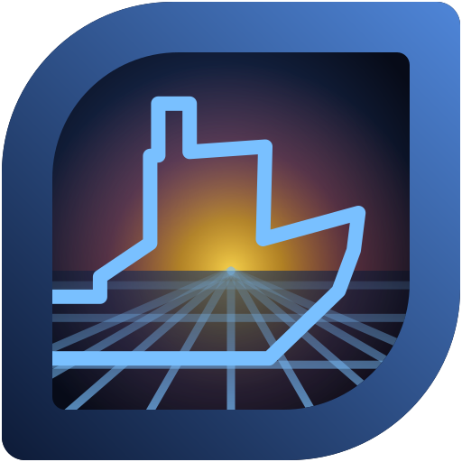
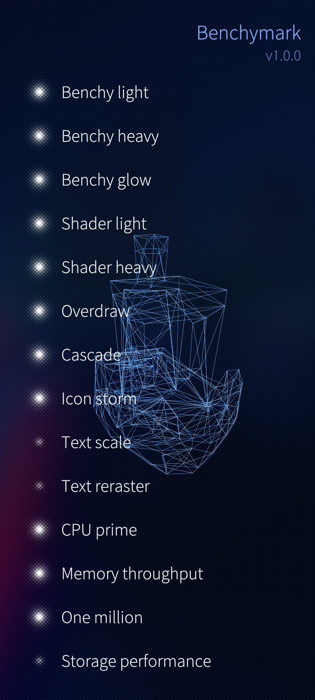

# benchymark


**A rendering benchmark for [AsteroidOS](https://asteroidos.org/) watches.**
Install it, tap it, and twelve fixed phases tell you what your watch is actually
good and bad at — with the frame rate live on the screen and a result file you
can keep.

https://github.com/user-attachments/assets/adec3f6d-6174-4b50-b96d-a8a980a92be8

## SailfishOS



The `sailfishos` branch is **Benchymark for SailfishOS phones**, the first
benchmark app for SailfishOS. In 2018 someone asked on talk.maemo.org for
exactly that ([*Missing benchmark application for Sailfish os*](https://talk.maemo.org/showthread.php?t=100457));
the author answered with the shell commands he had used for his 2016 device
comparison and wrote that *"some common linux commands could indeed be
utilized by an application and have a nice front end"*. This is that front end.

Tick the stages you want, choose **Run once** or **Run in loop**, start. Each
graphics stage runs for 10 seconds on a black background (the ambience must
not change the result), the system stages run their own course. At the end a
table with everything worth a screenshot: device and OS, resolution and GPU,
frames per second per stage and the system values. The last run is also kept
as JSON in `~/.local/share/net.mowerk/harbour-benchymark/last-run.json`.
Tap a stage name on the start page for one sentence on what it tests.



| stage | what it leans on |
|---|---|
| Benchy light | two 3DBenchy wireframes, each drawn 10 times: CPU projection, line drawing |
| Benchy heavy | six boats, each drawn 20 times: 120 wireframes a frame |
| Benchy glow | a Benchy with a pulsing blur halo over the whole screen |
| Shader light | a domain-warped noise field per pixel (the watch's CLOUDLIGHT) |
| Shader heavy | the doubly warped fBm field (the watch's CLOUDHEAVY) |
| Overdraw | 72 big translucent squares, turning: fill rate |
| Cascade | 1000 rounded squares in two transformed rings |
| Icon storm | 1440 SVG icons (flashes and Twemoji rockets) on spiral arms |
| Text scale | text resized by a scale transform, distance-field glyphs |
| Text reraster | the same picture by animating the font size: every glyph drawn again |
| CPU prime | sysbench's cpu event (primes up to 10000) on all cores, one per cell of an Ulam spiral; events/s |
| Memory throughput | memcpy between two 32 MB buffers; MB/s |
| One million | JavaScript counting to one million, over and over, in a worker; millions/s |
| Storage performance | 256 MB in 16 KB blocks with O_DIRECT, written and read, then deleted; MB/s. Off by default (flash wear) |

The system stages rebuild the author's 2016 console tests (sysbench cpu and
memory, `dd`, a bash counting loop) inside the app, because the sandbox runs
no outside tools; app and service start times from that list cannot be
measured from inside the sandbox at all. With the drawing running alongside,
the numbers are not comparable to the 2016 ones either.

**Not comparable with the watch.** The results are stamped scene `sfos-1.0`.
The loads were set on a Jolla C2 so that they spread from about 60 to 7 fps;
the watch's scene 0.6 runs other loads on another renderer (Qt 6), and Qt 5.6
on SailfishOS has no QtQuick.Shapes or MultiEffect, so the Benchy is drawn by
a C++ scene graph item (`src/Wireframe.*`), the shaders are GLSL ES 1.00
inline, and the frame count comes from the window's `frameSwapped` in C++.

Install: `devel-su pkcon install-local harbour-benchymark-1.0.0-1.<arch>.rpm`
(aarch64, armv7hl or i486; built for SailfishOS 4.5 and later). Build with the
Sailfish Platform SDK: `mb2 -t SailfishOS-4.5.0.18-aarch64 build`. The icon is
generated by `tools/benchy_icon.py`, the mesh header by `tools/mesh_to_header.py`.
Test hooks: `SFOS_SELFTEST_RUN=<stage index>` runs one stage at start,
`SFOS_SELFTEST_STOP=<s>` ends it after that many seconds.

Credits for the phone version: Twemoji graphics (c) Twitter, Inc and other
contributors, CC-BY 4.0 (the rocket); ionicons, MIT (the flash); the icon's
leaf shape after the SailfishOS stock icons.

The SailfishOS version was written by an LLM (Claude), directed by the
author: he chose the stages, their order and loads, the start page, the
results table and the icon, and tested every round on his Jolla C2.

```
Disclosure: LLMGD-3 · origin O1 (the author's app and his design for the phone, set and tested by him on a Jolla C2 over many rounds; LLM-implemented; self-graded)
LLMGD: v0.3; assurance=A3; flags=U,T; origin={O0:.5,O1:.5}; origin_headline=O1; scope=port(code+assets+packaging+docs); graded-by=claude-opus-5-5; retrieval=author-side
```

## The loop

3DBenchy exists to benchmark **3D printers**. This community 3D-prints
**custom docks** for its watches, and posts finished ones to members who have no
printer. So the little boat that certifies the printer, that makes the dock,
that holds the watch — now certifies the watch as well.

That is not decoration. Because QtQuick3D is absent on these images, nothing
here *loads* a model: the QML **is** the renderer, rotating the hull and
projecting it through a perspective divide every single frame. Your watch is
drawing, by arithmetic, the object that certified the printer that made its own
cradle.

## What you see

1. A **countdown**, so you can get to the watch before it starts.
2. **Twelve phases**, back to back, with a quiet two seconds between them. The
   name of the phase about to run fades up in the middle of that gap.
3. The **live FPS travels the screen rim**, trailing older readings behind it —
   the trail *is* the history, no graph needed. One lap per phase, so it starts
   and finishes at the top. Numerals drop to **red below 45 fps**.
4. A **COMPLETE** screen. Tap to run it again.

The whole run takes about three minutes and holds the screen awake by itself.

**Or take control.** Tap during the countdown and it pauses, offering two
buttons: **continue** (for a mis-tap) or **phase control**. In phase control the
current phase runs *indefinitely* and a tap moves to the next one — so you can
park on the one test you actually care about instead of waiting for it to come
round. Results from a manually-cut phase are marked `"manual": true`, because a
window you ended by hand is not comparable with a full one.

## Install

Grab the `.ipk` from [Releases](../../releases), then on the watch as root:

```sh
opkg install benchymark_*.ipk --force-reinstall --force-depends
```

It appears in the launcher as **Benchymark**. Building from source is in
[packaging/benchymark.bb](packaging/benchymark.bb).

## What it measures

Each phase isolates **one** cost path, so a result points at a cause instead of
handing you a score:

| phase | what it leans on |
|---|---|
| `IDLE` | nothing — the sanity floor. Should sit at a flat 60. |
| `SCALE` | scaling text with a transform |
| `RERASTER` | the **same picture**, resized the expensive way |
| `ORBIT` | a moving element with a pulsing halo |
| `OVERDRAW` | stacked translucent layers — raw fill rate |
| `DRAWCALLS` | many separate SVG icons in motion |
| `DRAWFONT` | the same storm as colour emoji glyphs |
| `SHAPES` | a vector path rebuilt every frame |
| `CASCADE` | two counter-rotating trees of moving children |
| `CLOUDLIGHT` | a domain-warped cloud, cheaply |
| `CLOUDHEAVY` | the same cloud, built to hurt |
| `BENCHY` | the boat, as a rotating wireframe |

**`SCALE` and `RERASTER` are the centrepiece.** They look *identical on screen*
and differ only in how the resize is done — a `scale` transform versus animating
`font.pixelSize`. Their ratio is the most transferable number in the run: on
nemo it is 55 against 21, which is what animating text size really costs.

The two **clouds** are one scene at two costs — 24 against 140 hash evaluations
per pixel — so the pair prices the domain warp and the `sin()`-based hash
together. `CLOUDHEAVY` is the deliberate worst case.

## Results

Each completed run is written to
`~/.local/share/benchymark/last-run.json`:

```json
{
 "scene": "0.6",
 "finished": "2026-08-29T18:52:11.000Z",
 "resolution": "384x384",
 "phases": [ { "phase": "IDLE", "avg": 60, "min": 59, "samples": 9,
               "worst_tick_ms": 118 } ]
}
```

One complete run per file, written when the last phase closes — so a tool
collecting these never reads a half-finished result. Fleet managers such as
[asteroid-docking-bay](https://github.com/moWerk/asteroid-docking-bay) can
install, launch and read it back over ADB or SSH.

## Comparing numbers honestly

- The **scene version** shows during the countdown and is stamped into every
  result. If the scene changes, old numbers are void.
- **Bigger panels do more work** in the fill-rate phases. That is real, so
  compare like with like, or report Mpix/s alongside FPS.
- Every phase runs ten seconds and **measures nine** — the first is discarded,
  because it straddles the gap and the scene's opening frames.
- **`worst_tick_ms`** is how far the worst one-second sampling window drifted
  from the second it asked for. The sampler runs on the GUI thread, which a
  GUI-bound phase starves, so a large value means the samples behind that
  average were counted over ragged windows even though each is normalised to
  its own. Small is trustworthy; on this rig it ranges from tens of
  milliseconds to about half a second.
- Watches have been seen **dropping off ADB** during the wireframe phase with
  the screen lit. The run itself does not need ADB; only reading the result does.

Full technical detail — architecture, how the frames are actually counted, the
mesh pipeline, and the meta-asteroid cleanup this was built to serve — is in the
[latest release notes](../../releases/latest).

## Credits

**3DBenchy** entered the public domain on 2025-02-14 (NTI Group). Credit to
Creative Tools / NTI Group is offered as good manners rather than obligation.
The mesh ships as a small coordinate table; the model itself is not in this
repository.

The layout comes from **digital-nutty-null**; the app structure derives from
**asteroid-flashlight** by Florent Revest.

Licensed **GPL-3.0-or-later**, matching the other AsteroidOS apps.

---

## LLM grading

This project was built with an LLM. Rather than leave that to inference, it is
graded against [LLMGD v0.2](https://github.com/moWerk/asteroid-docking-bay) and
the result published here — including the parts that do not flatter it.

<p align="center">
  
  
  
</p>

| flag | | meaning |
|---|:---:|---|
| **U** — Understood | ✅ **yes** | the human caught real defects the machine had missed |
| **T** — Tested | ✅ **yes** | built, packaged and run on hardware, results fed back |
| **R** — Read | ❌ **no** | nobody read the complete source before publication |
| **X** — External review | ⬜ **none** | the meta-asteroid-community PR is open, not yet reviewed |

**Origin** — machine-designed, with unusually specific human direction.

| | O0 | O1 | O2 | O3 | O4 |
|---|---|---|---|---|---|
| | 🟪 0.45 | 🟦 0.38 | 🟩 0.11 | 🟨 0.06 | ⬜ 0.00 |
| | machine chose design **and** expression | human specced, machine designed details | human designed, machine expressed | machine edited human material | no LLM |

O0 and O1 land close together, and that is the honest picture rather than a
tidy one. The internal architecture — the per-phase `Loader` split, counting
`frameSwapped`, the `RotationAnimator` sweep, the mesh pipeline, the
`sceneReady` gate — was machine-designed from a reported symptom. But a great
deal of the *visible* design was named outright by the human, down to
"fade it in over 200ms, let it stand for 1200 and fade out in 600", "the upper
button anchored to vertical centre with its bottom", and "starts from 06:00 and
rotates 1.5 times". A stricter reading of those tips the headline to **O1**.

### Why the assurance is A3 and not higher

**A3 is the ceiling this way of working can honestly reach.** When a machine
writes most of the code, control is not exercised by reading the diff — it is
exercised by catching what the code gets wrong. So `R: no` here is the expected
state, not a lapse; A4 would require a breadth-review that did not happen.

The **U** evidence is the part worth trusting, because it is costly and it
repeatedly went against the machine:

- **The human diagnosed a measurement bug the machine had asserted was fine.**
  *"the shapes look butter smooth 50-60fps. but the fps display claims 20. And
  additionally, the rotation that was supposed to be smooth, does now chopp and
  jump frames approximately in the framerate it displays."* That is Qt Quick's
  render thread versus its GUI thread, spotted from the couch. The counter was
  measuring its own scheduling.
- **The human designed the experiment that falsified the machine's hypothesis.**
  *"Can you install v0.1 once again on nemo so i can rule out issues with the
  watch"* — a controlled A/B that proved a frame-rate ceiling was the watch, not
  the app, after the machine had spent a cycle assuming otherwise.
- **The human refused a diagnostic question and named the right move.** *"dont
  make me answer stupid questions … Can you please fucking grep the shitty blue
  over the code base"* — the grep found `Application.centerColor` overriding the
  `.desktop` entry in one line, after the machine had proposed a further round
  of tests.
- **The human corrected the machine with domain knowledge it lacked.** *"nemo
  keep alive is not actually working. are you sure you used the latest qt6
  implementation? i only last week updated the flashlight"*.
- **The human reversed his own instruction when shown the cost.** *"revert the
  8s, the 5% impact is unintended, thanks for the push back"*; and later
  *"ignore my sort phases by fps, that was foolish"*.

**T** is real but narrower than it sounds, and the limit matters: **benchymark
has no automated test suite.** Testing means clean-from-`cleansstate` builds,
unpacking the resulting `.ipk` to verify its payload, installing to nemo
(MSM8926, 480×480) and sawfish (390×390), and running end to end with results
read back. The recipe in this PR was built from its pinned `SRCREV` before the
PR was opened — which is how a fetch failure was found. The sibling project
(`asteroid-docking-bay`) does carry a 543-test suite with planted-bug
validation; this one does not.

### What this grade does not cover

- **Two watches, not a fleet.** Every number quoted comes from nemo and
  sawfish.
- **The numbers moved four times during development**, each time because the
  measurement was wrong rather than because the app got faster. The fourth was
  v0.3: the sampler divided its frame count by the second it had *asked* for
  instead of the one it *got*, and reported up to 67 fps on a panel capped at
  60. Only results from v0.6 onward are meaningful, and only against v0.6.
- **Self-graded.** This verdict was produced by the author's agent — the same
  agent that wrote the code. The retrieval log below exists so the search can be
  audited rather than trusted; an independent re-run is the only thing that
  removes the conflict.

<details>
<summary><b>Retrieval log</b> (what was searched, found, and skipped)</summary>

**Run:** author-side · first run · grader: Claude Opus 4.6

**Searched:** `~/.claude/projects/-home-mo-Git-asteroid-docking-bay/*.jsonl`
(7 transcripts), sibling `<session-id>/` directories for sub-agent output, and
all transcripts grepped for continuation backlinks.

**Found — benchymark work lives in exactly one transcript:**

| id | size | records | method |
|---|---|---|---|
| `2adde14e…` | 18.9 MB | 6 747 | stream-filtered (236 user turns extracted; 955 benchymark hits) |

**Excluded after search, not assumed:** `b6d31eda…` (43.9 MB), `2bdab08b…`
(41.9 MB), `b053e086…` (3.6 MB) share the `aiTitle` *"Set up asteroid-docking-bay
project repository"* and contain **zero** benchymark hits. Three stub
transcripts (<7 KB) contain none either. UUID scan for continuation backlinks
returned only BLE service UUIDs — no session fork. No sub-agent directory exists
for the benchymark session.

**Lexicons run (the standard set, verbatim, over user turns only):**

| lexicon | turns matching |
|---|---|
| U / correction | 36 / 236 |
| R / review | 6 / 236 (none benchymark-scoped) |
| code-engagement | 10 / 236 |

Also counted: **32 `Request interrupted` markers** — the human stopping the
machine mid-action, which is itself a costly-oversight signal.

**Not read whole:** the 18.9 MB transcript, per the stream-filter method the
rubric prescribes for oversized transcripts. **Coverage: full.**

</details>
